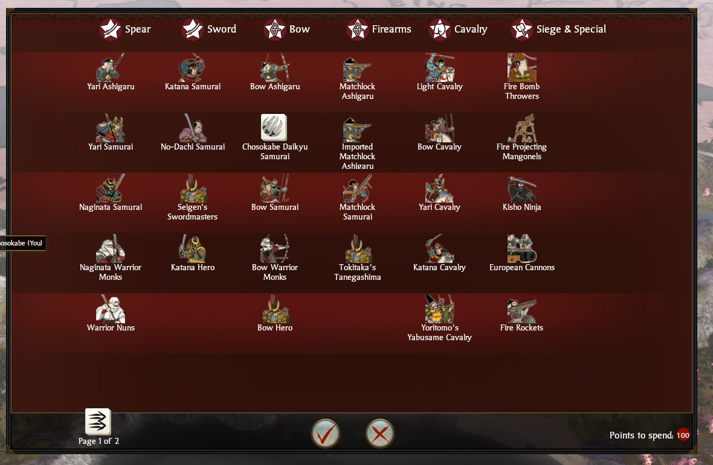
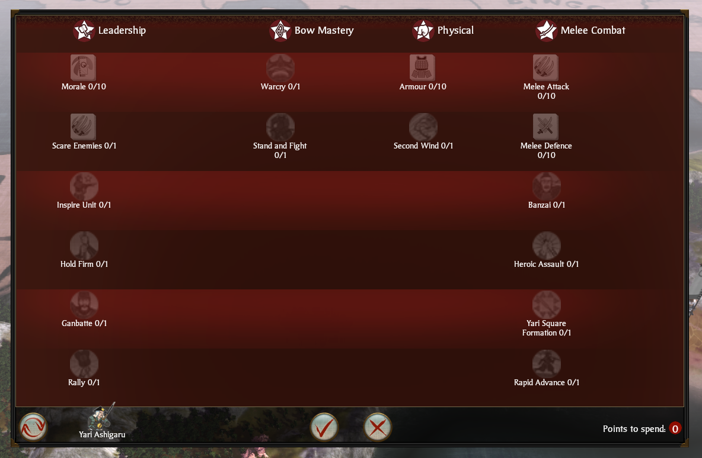

# Veteran Upgrades: Patched Edition

*A single-player mod for **Total War: Shogun 2***

Works in all three campaigns: **Sengoku Jidai**, **Rise of the Samurai** and **Fall of the Samurai**.
Playing the **Master of Strategy Sengoku (MoSS)** overhaul? Use the [MoSS version](#two-editions).

[](https://github.com/keanfreeman/shogun2-veteran-upgrades-patched/actions/workflows/verify.yml)

Your clan earns a point for every battle it fights and spends points on **upgrades for each unit type**:

- **Stats:** melee attack and defence, armour, morale, accuracy, charge, speed, reload, ammunition,
  range, bonus vs cavalry
- **Traits:** fire while hidden, camouflage, guerrilla deployment, fatigue resistance, Scare Enemies
- **Abilities** such as War Cry, Rally, Inspire, Rapid Volley, Fire by Rank, Pike Wall or Wedge

Upgrades apply at once to every unit of that type, including the ones already in your armies. AI clans
play too. Most of this needs a **small, reversible patch** to one game file (included); without it only
the basic stats, Scare Enemies and fatigue resistance work.

| Pick a unit type... | ...and buy its upgrades |
|---|---|
|  |  |

## Two editions

| Edition | For | Download |
|---|---|---|
| **Patched Edition** | The base game: Sengoku, Rise of the Samurai, Fall of the Samurai | [Latest release](https://github.com/keanfreeman/shogun2-veteran-upgrades-patched/releases/latest) |
| **Patched Edition for MoSS** *(new, pre-release)* | The [Master of Strategy Sengoku](mod-moss/README.md) overhaul: its units, clans and ability names | [moss-v1.0.0](https://github.com/keanfreeman/shogun2-veteran-upgrades-patched/releases/tag/moss-v1.0.0) |

Both use the same patch. **Enable only one Veteran Upgrades mod at a time**, including the Workshop's
[Veteran Upgrades](https://github.com/keanfreeman/shogun2-veteran-upgrades), which needs no patch:
they all change the same game file.

## Before you start

- **Steam version on Windows** (or Linux through Proton). The native Mac/Linux versions aren't supported.
- **Single-player only.** Online play uses Valve Anti-Cheat, and a changed game file could get your
  account banned. The mod switches multiplayer and drop-in battles off; **restore the game before
  playing online** (see below).
- After a Steam update the patcher may refuse to run until the mod is updated. That's on purpose.

## Installing

1. Download the zip from the release (see the table above). On Windows, right-click it → **Properties**
   → tick **Unblock**, then extract it.
2. Quit Shogun 2. Copy the `.pack` and `.png` into the game's `data` folder (Steam: right-click
   Shogun 2 → **Manage** → **Browse local files** → `data`).
3. Run **`patcher/Install patch.bat`** (Linux: `python3 patcher/patch_game.py install`). It should end
   with *"Patched (patch version 4)"*. If Windows warns, click **More info** → **Run anyway**.
4. Tick the mod in the launcher (MoSS edition: also MoSS's packs) and start a new campaign.

On the campaign map, click **Veterans** (below the advisor button), pick a unit type, choose upgrades and
press **OK**. **Reset** refunds a unit type for a small fee. Some abilities also need their usual research
or a general's skill; the tooltip says which.

**Updating from 1.0:** replace the files in `data` and run `Install patch.bat` again (2.0 needs patch v4).

## Uninstalling / before playing multiplayer

Quit the game and run **`patcher/Restore game.bat`** (Linux: `python3 patcher/patch_game.py restore`),
or use Steam's **Verify integrity of game files**. Then untick the mod. Restoring doesn't switch the
game's "allow drop-in battles" setting back on; tick it again if you want it.

## Troubleshooting

| Problem | What to do |
|---|---|
| *"Shogun 2 not found"* | Pass your game folder: `powershell -ExecutionPolicy Bypass -File patch_game.ps1 install -GameDir "D:\...\Total War SHOGUN 2"` |
| *"Refusing: the game DLL is unknown"* | Your game version differs (usually a Steam update). Verify the game files and retry; otherwise wait for an update. |
| No Veterans button | Fully restart the game, and make sure only one Veteran Upgrades mod is enabled. |
| Upgrades say *"Needs the game patch"* | Run `Install patch.bat` again (Steam may have restored the file). |
| Anything else | Open an [issue](https://github.com/keanfreeman/shogun2-veteran-upgrades-patched/issues) with `vu_log.txt` from the game folder. |

## Is the patch safe?

- **One file:** it changes `empire.retail.dll` (596 bytes in 18 places, all listed and explained in
  [docs/PATCH.md](docs/PATCH.md)) after saving the original as `empire.retail.dll.vanilla`.
- **Only the exact game version it knows** (checked by SHA-256), and **reversible** with `Restore game.bat`.
- **Nothing hidden:** the patchers in [player/](player/) are short, readable scripts that need no
  network, admin rights or other programs. CI rebuilds the patch from [patch.py](patch.py) and checks the
  patchers match it, and runs the new code in an emulated CPU. Releases list SHA-256 checksums.

This is an unofficial mod, not supported by Creative Assembly or SEGA. Use it at your own risk.

## Why patch the game?

Shogun 2 can unlock an ability for a whole clan or army, but not for one unit type, and charge, speed,
reload, ammunition and range bonuses only exist for whole classes of units. The Workshop mod works
around this with upgraded unit *copies* you must recruit or retrain into. The patch adds the missing
per-unit-type checks, so the units you already have simply gain the upgrade.

---

## For developers

**How it works.** A mod attaches a *clone* ability record to a unit type: `vuNN_<ability>`, a copy of the
real ability with `supersedes_ability` set (NN = a bit, 00-20). Buying the ability applies an effect that
sets bit NN in the unit type's `general_aoe_mod` bonus. The patched game sees the bit and grants the real
ability, after any research it needs (`vuNNf...` waives that). Without the patch, clones are ignored.
Patch v4 also adds per-unit-type charge, reload, range, speed, ammunition and bonus vs cavalry, three
unit traits (bits 21-23), and switches drop-in battles off. [docs/PATCH.md](docs/PATCH.md) has the full
disassembly.

| Path | What |
|---|---|
| [patch.py](patch.py) | The patch as readable assembly, plus `show` / `status` / `apply` / `restore` |
| [player/](player/) | What players run (PowerShell + `.bat`, or Python); generated by `tools/make_patchers.py` |
| [abilities.py](abilities.py), [detect.lua](detect.lua) | Clone keys and bit assignment; patch detection from Lua |
| [mod/](mod/) | The Patched Edition (base game) |
| [mod-moss/](mod-moss/) | The Patched Edition for MoSS |
| [tools/](tools/) | `verify_patchers.py` and `emulate_patch.py` (CI), `snapshot.py` (build without the game) |
| [testpack/](testpack/) | Minimal test mods for the patch |

```
python3 -m venv .venv && .venv/bin/pip install keystone-engine capstone pefile unicorn
.venv/bin/python patch.py show            # the patch, disassembled
.venv/bin/python tools/verify_patchers.py # check player/ and docs/PATCH.md
.venv/bin/python tools/emulate_patch.py   # run the patch's routines in an emulated CPU
```

Each mod is built with `tools/release.py` in its folder (it reads your game's data and RPFM's schema)
and tested with `tests/run_tests.py`; see its README.
